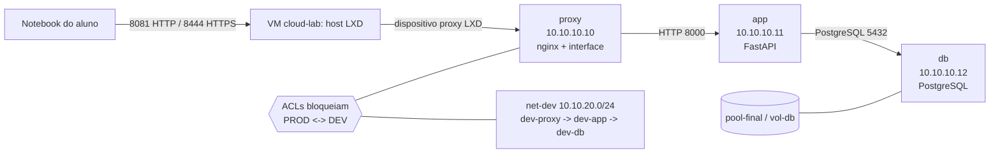

# Arquitetura - Trilha B (API de tarefas)

| Camada | Responsabilidade | Exposição |
|---|---|---|
| proxy | Nginx, frontend estático e término TLS | Única camada publicada |
| app | Endpoints FastAPI e regra de negócio | Apenas rede privada |
| db | PostgreSQL com dados em `vol-db` | Apenas `app:5432` |

As redes `net-prod` e `net-dev` usam bridges distintas e NAT apenas para saída. As ACLs eliminam o roteamento entre elas. O volume tem ciclo de vida independente da instância, portanto o banco pode ser recriado sem perder os dados.

